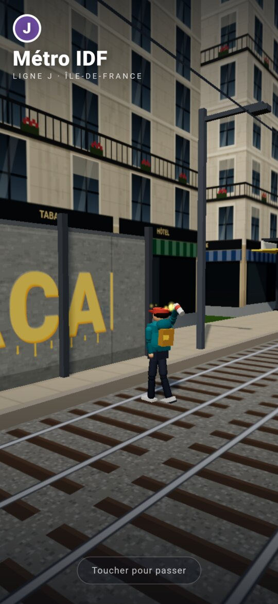
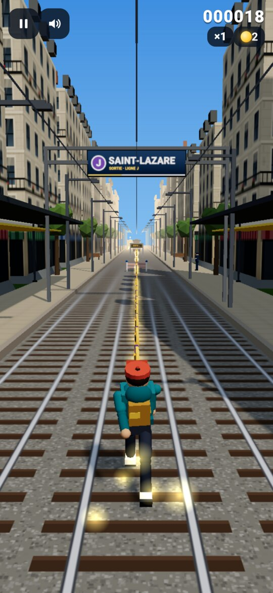
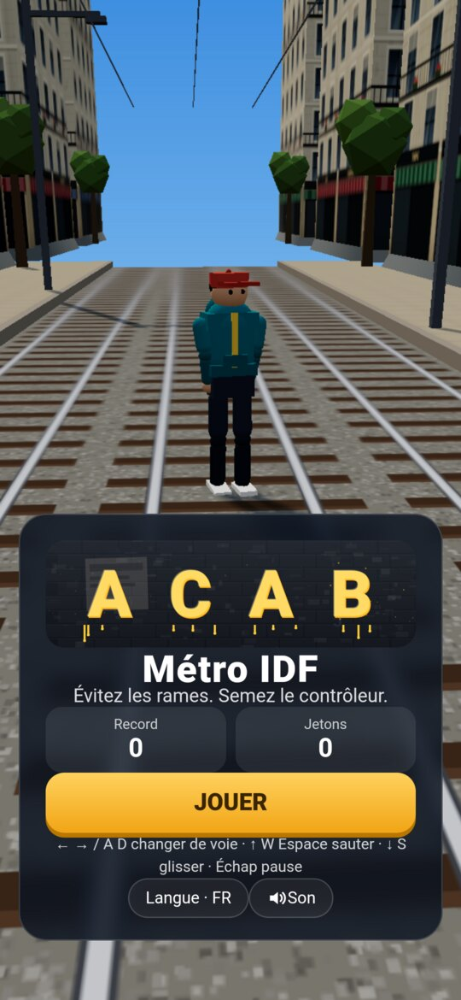

# Métro IDF

Runner 3D à trois voies pour Android, dans l'Île-de-France. Sans publicité, hors-ligne, sans compte.

On court sur la **ligne J** : Saint-Lazare → Mantes-la-Jolie via Poissy, puis les branches
Ermont et Conflans, avec les vraies gares du réseau.

| Intro | Course | Écran-titre |
|---|---|---|
|  |  |  |

## Ce qu'il y a dans le jeu

**Ouverture (scène 3D)**
- le personnage s'approche d'une palissade le long des voies, secoue une bombe et tagge
  **ACAB** lettre par lettre, avec coulures et nuage de peinture ;
- un agent en bleu arrive sur le quai, coup de sifflet : le personnage détale.
- la scène se passe dans le vrai décor (façades, commerces, quai) et peut être passée d'un toucher.

**Décor**
- façades haussmanniennes dessinées : pierre, fenêtres, balcons en fonte, toits de zinc,
  cheminées, commerces (café, tabac, boulangerie, pharmacie, hôtel) ;
- quatre ambiances selon la gare : Paris dense, banlieue pavillonnaire, **bords de Seine**
  (le fleuve, la berge), forêt (Clairières de Verneuil, Épône), ville (Mantes, Poissy) ;
- arbres d'alignement, bancs, canopées de quai, murs taggés, **ponts de pierre** au-dessus
  de la voie, **entrées de métro** à Paris, horizon de tours.

**Rames**
- caisse crème, toit arrondi, bandeau fenêtres, portes violettes, ligne jaune ;
- pare-brise avec visor, bandeau de destination (« MANTES-LA-JOLIE »), phares, attelage,
  pantographe, bogies et roues.

**Gares réelles**
- portiques avec le nom exact de la gare, rondel de la ligne J et « SORTIE · LIGNE J » ;
- bandeau d'arrivée et carillon à chaque gare ;
- tour complet joué en boucle : Paris → Houilles → Poissy → Villennes → Verneuil →
  Les Mureaux → Épône → Mantes → Ermont → Conflans → retour.

**Personnage**
- personnage original (capuche turquoise, casquette rouge, sacoche), articulé et animé à la main :
  course, saut, glissade, chute, et la pose « bombe levée » de l'intro.

**Obstacles**
- barrières rouge et blanc à boules bleues, portiques « SORTIE », rampes pour monter sur les rames,
  trains croiseurs, aimant, chaussures à ressorts, score doublé.

**HUD**
- pause et son à gauche, score, multiplicateur et jetons à droite, bandeau de gare à l'arrivée.

## Données des lignes

`web/routes/j.json` : les 3 branches de la ligne J, extraites du GTFS officiel
Île-de-France Mobilités (40 gares, noms exacts, coordonnées).

- J5 · Saint-Lazare → Mantes-la-Jolie via Poissy (11 gares)
- J · Saint-Lazare → Mantes via Conflans (21 gares)
- J · Saint-Lazare → Ermont-Eaubonne (8 gares)

## Construire

**Jeu web** (three.js + Vite) :

```bash
cd web
npm install
npm run build      # génère web/dist
```

**APK Android** (WebView, assets embarqués) :

```bash
# copier le build web dans les assets
rm -rf app/src/main/assets/* && cp -r web/dist/* app/src/main/assets/
./gradlew :app:assembleRelease
```

L'APK sert les fichiers via `WebViewAssetLoader` (https local) pour que `fetch()`, WebGL et
le stockage fonctionnent hors-ligne. Aucun fichier 3D n'est téléchargé : tout est dessiné au
démarrage (textures canvas + primitives three.js).

## Contrôles

- glisser à gauche/droite : changer de voie
- glisser vers le haut : sauter
- glisser vers le bas : glisser sous un obstacle
- bouton pause en haut à gauche

## Licence

© 2026 Joynix. Tous droits réservés.
