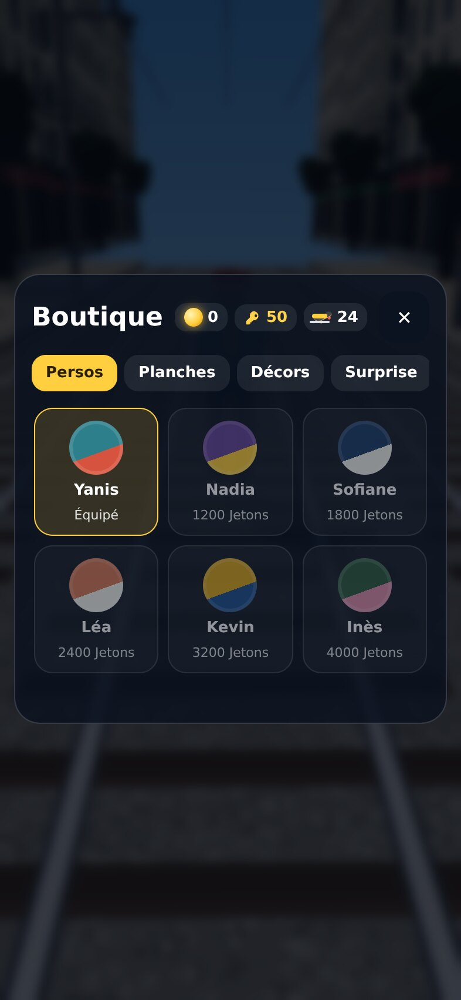
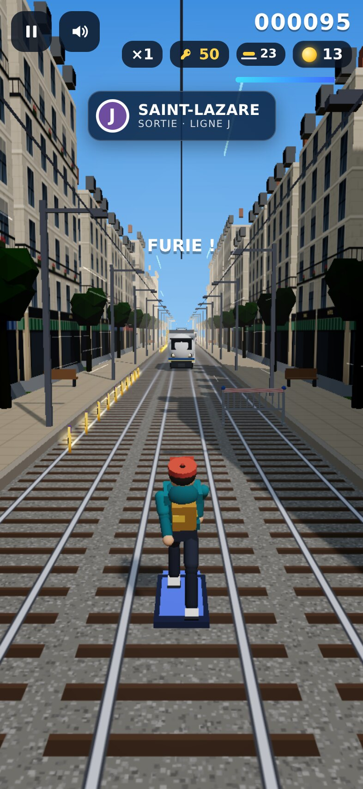

<p align="center">
  
</p>

<h1 align="center">Surfer Du Metro</h1>

<p align="center">
  <b>Cours sur les toits des rames. Sème le contrôleur. Ne t'arrête jamais.</b><br>
  Un runner 3D à trois voies, pour le téléphone, dans le vrai réseau d'Île-de-France.
</p>

<p align="center">
  <a href="https://github.com/joynix28/surfer-du-metro/releases/latest"></a>
  
  
  
</p>

---

## Le jeu

Tu es un graffeur. Tu viens de taguer une palissade au bord des voies quand un contrôleur
te repère. Une seule issue : **courir**.

Tu files le long des quais, tu sautes les barrières, tu glisses sous les portiques, tu montes
sur les rames par les rampes et tu tiens le plus longtemps possible sur **sept lignes réelles**
du réseau francilien. Les rames arrivent de face, les trains croiseurs te foncent dessus, et
le décor change à chaque gare : Paris haussmannien, banlieue pavillonnaire, bords de Seine,
forêt, tours de La Défense, tour Eiffel au loin.

Pas de pub, pas de compte, pas de connexion. Le jeu tient dans 2 Mo et tourne hors-ligne.

## Ce qu'il y a dedans

**Course**
- trois voies, saut, glissade, changement de voie, réception sur les toits de rame ;
- difficulté qui monte avec la distance, multiplicateur de score jusqu'à ×6 ;
- **collisions instantanées**, deux chocs rapprochés et le contrôleur t'attrape.

**Boutique, inventaire et personnages**
- **boutique** accessible depuis l'écran-titre (et la pause) : personnages, planches, décors, boîte surprise ;
- **6 personnages** à débloquer (couleurs de capuche, casquette, sac) ;
- **5 planches** (Classique, Coucher de soleil, Néon, Or, Graffiti) ;
- **5 décors** qui changent l'ambiance du monde : Paris, Néon, Automne, Hiver, Été ;
- **boîte surprise** : un objet non possédé au hasard (ou des jetons si tout est collectionné) ;
- tout est sauvegardé sur le téléphone.

**Planche et furie**
- les planches ramassées en course vont dans l'**inventaire** ;
- **double-tap** en course : tu sors une planche → **furie** de 9 s, **vitesse doublée** et
  aucune collision. Le compteur de planches est dans le HUD ;
- la planche équipée change de couleur (pont et bande).

**Clés et sauvetage**
- des clés dorées traînent le long des voies ;
- après une chute, tu peux **repartir au même endroit** avec une clé ;
- le prix **double à chaque sauvetage** de la même partie : 1, 2, 4, 8 clés…

**Power-ups**
- **planche** : elle encaisse un choc puis disparaît ;
- **aimant** : attire les jetons des voies voisines ;
- **chaussures à ressorts** : sauts plus hauts ;
- **score doublé**.

**Monde**
- **sept lignes** avec le bon rondel et la bonne couleur à chaque gare ;
- façades haussmanniennes dessinées : pierre, balcons en fonte, toits de zinc, commerces ;
- ambiance par secteur : Paris dense, banlieue, **bords de Seine**, forêt, ville ;
- **tour Eiffel** au-dessus des toits (Trocadéro / Iéna / Alma), **tours de La Défense** ;
- ponts de pierre, entrées de métro, canopées de quai, bancs, murs taggés ;
- **cycle jour → crépuscule → nuit → aube** en ~7 minutes, lampadaires allumés la nuit ;
- averses sur certaines gares : pluie, brume, ciel gris.

**Rames**
- trois livrées (Transilien crème/violet, TGV gris/bleu, métro blanc/turquoise) ;
- nez arrondi, pare-brise incliné, bandeau de destination, phares cerclés, pantographe, bogies ;
- trains croiseurs qui **roulent à la vitesse du joueur**.

**Sons d'ambiance**
- jingle de gare et annonce étouffée à chaque arrivée, **bips de fermeture des portes** ;
- **brouhaha** de quai, **train qui passe** avec souffle, roulement des rames ;
- le tout synthétisé, aucun fichier audio.

**Arrestation**
- quand le contrôleur t'attrape, une courte scène : l'agent s'approche, tu passes **menotté**
  (mains dans le dos, menottes visibles), puis l'écran de fin.

**Ouverture**
- une vraie scène 3D : le personnage s'approche d'une palissade, secoue sa bombe et tagge
  **ACAB** lettre par lettre, coulures et nuage de peinture ; le contrôleur arrive, coup de
  sifflet, il détale. Passable d'un toucher.

## Les lignes

| Ligne | Parcours | Gares |
|---|---|---|
| **J** | Saint-Lazare → Mantes-la-Jolie (via Poissy) | 11 |
| **RER A** | Nanterre-Préfecture → Val de Fontenay | 9 |
| **Métro 1** | Château de Vincennes → La Défense | 25 |
| **Métro 8** | Invalides → Créteil-Préfecture | 29 |
| **Métro 9** | Pont de Sèvres → Mairie de Montreuil | 37 |
| **Tram T2** | Porte de Versailles → Pont de Bezons | 24 |
| **Tram T9** | Porte de Choisy → Orly | 19 |

Le tour complet est joué en boucle. Les noms de gares viennent du **GTFS officiel
Île-de-France Mobilités** (`web/routes/j.json` et `web/src/data/route.ts`).

## Captures

| Ouverture | Course | Écran-titre |
|---|---|---|
|  |  |  |
|  |  | |

## Installer

1. Télécharge l'**APK** sur la page [Releases](https://github.com/joynix28/surfer-du-metro/releases/latest).
2. Ouvre le fichier sur ton téléphone et autorise l'installation (Android 8 ou plus).
3. Lance **Surfer Du Metro**. Aucun compte, aucune connexion demandée.

## Commandes

- **glisser à gauche / à droite** : changer de voie
- **glisser vers le haut** : sauter
- **glisser vers le bas** : glisser sous un obstacle
- **bouton pause** en haut à gauche

## Technique

- moteur maison en **TypeScript + three.js**, 60 fps visés, rendu instancié (un appel par type
  d'objet), aucun fichier 3D à télécharger : **tout est généré au démarrage** (textures canvas
  et primitives) ;
- simulation séparée du rendu (`web/src/sim`) : pas, collisions par intervalle, recherche de
  chemin pour garantir une map toujours traversable ;
- 61 tests headless couvrent les collisions, les rampes, les trains croiseurs, la génération de
  map sur 20 km et l'autopilote sur 8 km ;
- empaquetage Android en **WebView** avec `WebViewAssetLoader` (https local) pour que WebGL et
  le stockage fonctionnent hors-ligne.

## Construire

**Jeu web**

```bash
cd web
npm install
npm run build      # génère web/dist
```

**APK**

```bash
# copier le build web dans les assets de l'app
rm -rf app/src/main/assets/* && cp -r web/dist/* app/src/main/assets/
./gradlew :app:assembleRelease
```

Sans fichier `keys/keystore.properties`, l'APK est construit non signé.

## Structure

```
app/            enveloppe Android (WebView plein écran, icône, manifeste)
web/            jeu TypeScript / three.js
  src/sim/      règles : runner, obstacles, génération de map
  src/view/     rendu : décor, rames, personnages, intro, météo
  src/data/     lignes et gares (GTFS)
  routes/       données de la ligne J
  tests/        tests headless (CDP)
docs/           captures
```

## Licence

© 2026 Joynix. Tous droits réservés.
